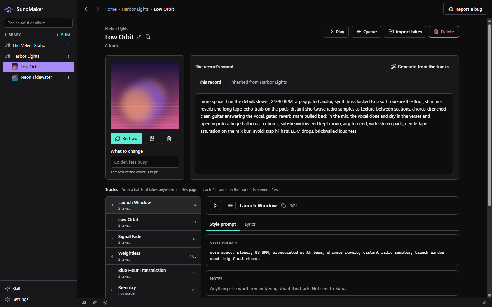
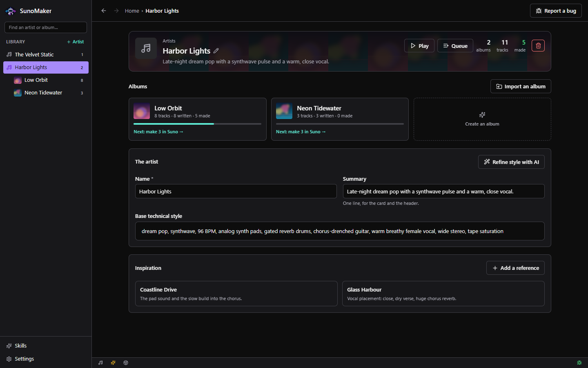
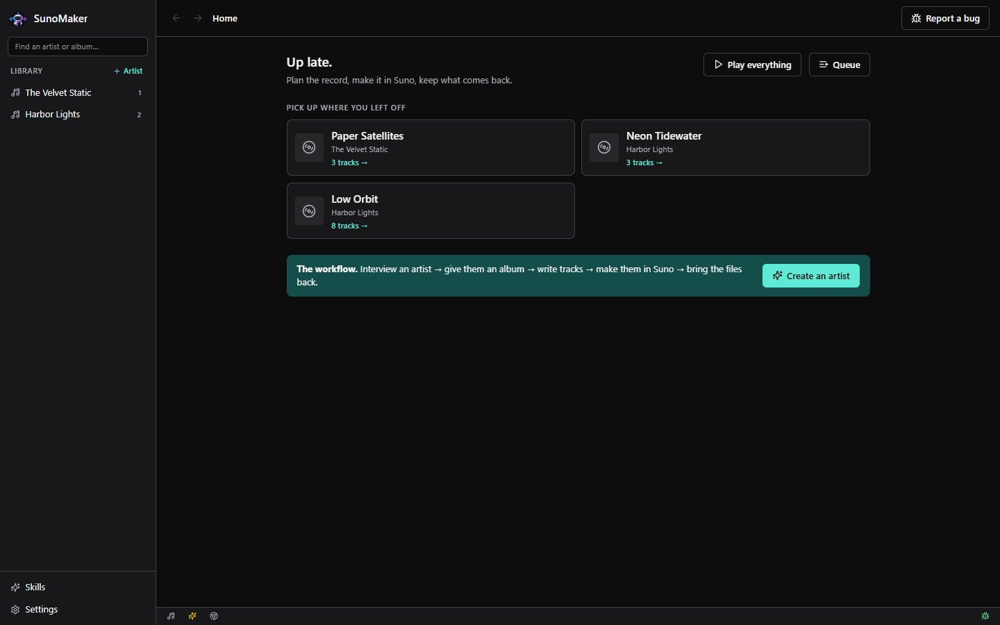
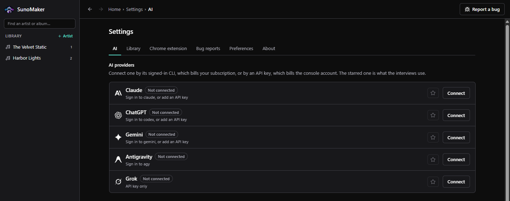

# AIMusicMaker

**Plan music before [Suno](https://suno.com) makes it, and keep what Suno gives back.**

AIMusicMaker is a free, open-source desktop app for Windows, macOS and Linux. It keeps
your artists, albums and tracks in one library, writes Suno style prompts and
lyrics with the AI you already use, fills Suno's create form for you, and files
the finished songs where your music player will find them.

**License:** [MIT](LICENSE)



> Prebuilt Windows, macOS and Linux builds are on the
> [Releases](https://github.com/WillMakes/ai-music-maker/releases) page, or you
> can build it yourself with Go as described below.

---

## Contents

- [What it does](#what-it-does)
- [Screenshots](#screenshots)
- [Requirements](#requirements)
- [Build and install](#build-and-install)
- [First run](#first-run)
- [Using AIMusicMaker](#using-aimusicmaker)
- [Command line](#command-line)
- [Now playing API](#now-playing-api)
- [Where your files live](#where-your-files-live)
- [Development](#development)
- [Reporting bugs and contributing](#reporting-bugs-and-contributing)
- [License](#license)

## What it does

- **A library shaped like a discography.** Each artist has a base style and the
  references it came from. Each album has a cover, its own style and its release
  links. Each track has a title, a Suno style prompt, lyrics, a target length,
  and every take Suno gave back.
- **AI interviews that write for you.** A conversation settles an artist's
  sound, an album's concept and cover, and a batch of tracks with prompts and
  lyrics. It works with Claude, ChatGPT, Gemini, Antigravity or Grok, through
  your signed-in CLI or an API key.
- **Album artwork.** Covers are generated from the album's description or
  dropped in from a file.
- **A Chrome extension for Suno.** One click fills Suno's Lyrics, Style, Title
  and Duration fields from a track.
- **Your takes, filed properly.** Audio is copied into your music folder as
  `Artist/Album/01 Track.mp3`. WAVs become 320 kbps MP3s when ffmpeg is
  installed.
- **A built-in music player** for listening back through an album's takes.
- **Works with AI assistants.** An MCP server gives Claude Code, Claude Desktop,
  Codex, Gemini CLI, Antigravity and Grok everything the window can do.

## Screenshots

The screenshots show a made-up demo library.

**An artist.** Their albums and how far each has got, the base style every
album inherits, and the references it was decided from.



**Home.** Pick up where you left off, or start the next artist.



**AI providers.** Connect through a signed-in CLI or an API key, and star the
one the interviews use.



## Requirements

Everyone needs:

| Tool | Version | Get it |
| --- | --- | --- |
| Go | 1.25 or newer | [go.dev/dl](https://go.dev/dl/) |
| Node.js | 20 or newer, with npm | [nodejs.org](https://nodejs.org/) |
| Wails CLI | v2.13 | `go install github.com/wailsapp/wails/v2/cmd/wails@v2.13.0` |
| Git | any recent | [git-scm.com](https://git-scm.com/) |

Plus what your platform needs to host a desktop web view:

| Platform | Also install |
| --- | --- |
| **Windows 10/11** | Nothing. The WebView2 runtime ships with Windows 11 and current Windows 10. |
| **macOS** | Xcode Command Line Tools: `xcode-select --install` |
| **Linux** | A C compiler, GTK 3 and WebKit2GTK. Debian/Ubuntu: `sudo apt install build-essential pkg-config libgtk-3-dev libwebkit2gtk-4.1-dev` (see the note below on 4.0 and 4.1) |

Run `wails doctor` after installing. It checks all of the above and tells you
what is missing.

**Optional, but worth having:**

| Tool | What it adds |
| --- | --- |
| [Google Chrome](https://www.google.com/chrome/) | The Suno extension, which fills Suno's form. |
| [ffmpeg](https://ffmpeg.org/download.html) | WAV takes are converted to 320 kbps MP3. Without it they stay WAV. |
| An AI CLI: [`claude`](https://docs.anthropic.com/en/docs/claude-code), [`codex`](https://github.com/openai/codex), [`gemini`](https://github.com/google-gemini/gemini-cli) or `agy` | Use your existing subscription instead of an API key. |
| [GitHub CLI](https://cli.github.com/) (`gh`) | Signs the in-app bug reporter in to GitHub. |

## Build and install

**Or download a build.** Every merge to `main` publishes a release on the
repository's Releases page, with a build for each platform:

| Platform | Asset | Notes |
| --- | --- | --- |
| Windows | `AIMusicMaker-vX.Y.Z-windows-amd64-setup.exe` | An installer, with Start menu shortcuts and an uninstaller. Run a newer one over an installed copy to update it in place. Unsigned: SmartScreen asks once. |
| macOS | `AIMusicMaker-vX.Y.Z-macos-universal.dmg` | Apple silicon and Intel. Drag the app into Applications. Unsigned: right-click → Open the first time. |
| Linux | `AIMusicMaker-vX.Y.Z-linux-amd64.tar.gz` | Built on Ubuntu 24.04 against WebKit2GTK 4.1. |

The workflow is `.github/workflows/release.yml`. It numbers releases by bumping
the patch of the latest `v*` tag, and attaches a `manifest.json` and
`checksums.txt` naming each platform's file and its SHA-256.

**Updating.** An installed release checks for a newer one at launch and every
few hours. When there is one, an **Update Available** button appears in the top
bar beside Report a bug: it shows the release notes, downloads the file for
your platform to your Downloads folder, checks it against the release's
checksum, and opens it. On Windows that runs the installer, which updates the
installed copy in place. **Settings → About** checks on demand. The repository
is private, so checking needs a GitHub credential, the same one the bug
reporter uses (`gh auth login`). A build made from source says `dev` and does
not check.

To build from source:

```bash
# 1. Get the source
git clone https://github.com/WillMakes/ai-music-maker.git
cd ai-music-maker

# 2. Install the Wails CLI (once)
go install github.com/wailsapp/wails/v2/cmd/wails@v2.13.0

# 3. Check your machine has everything
wails doctor

# 4. Build
wails build
```

`wails build` installs the frontend's npm packages, compiles the React UI,
embeds it, and produces one self-contained program:

| Platform | Output |
| --- | --- |
| Windows | `build/bin/aimusicmaker.exe` |
| macOS | `build/bin/aimusicmaker.app` |
| Linux | `build/bin/aimusicmaker` |

Run it from there, or move it wherever you keep applications. The program has
no other files to carry with it.

> **Linux: WebKit2GTK 4.0 or 4.1.** Wails links WebKit2GTK 4.0 unless told
> otherwise. Newer distributions (Ubuntu 24.04, Debian 13, Fedora 40 and later)
> ship only 4.1. With `libwebkit2gtk-4.1-dev` installed, build with
> `wails build -tags webkit2_41` (and `wails dev -tags webkit2_41`). On Ubuntu
> 22.04 and older, install `libwebkit2gtk-4.0-dev` and build without the tag.

**Updating** is a pull and a rebuild. Your library is stored outside the source
folder and carries over.

```bash
git pull
wails build
```

> `go build` on its own will not produce a working app. The UI has to be built
> and embedded first, which is what `wails build` does.

## First run

1. **Connect an AI.** Open **Settings → AI**. Pick a provider and either use
   its signed-in CLI or paste an API key. Keys are checked with the provider
   before they are saved. Star one as the default. Album artwork is generated
   with ChatGPT, through the `codex` CLI or an OpenAI API key.
2. **Check the music folder.** **Settings → Library** shows where audio is
   filed. It defaults to your system's Music folder.
3. **Install the Chrome extension** if you use Suno in Chrome. In **Settings →
   Chrome extension**, choose **Export the extension**. Then open
   `chrome://extensions`, turn on **Developer mode**, choose **Load unpacked**,
   and select the folder the panel shows. Export again after each update so
   Chrome gets the new version.
4. **Optionally, connect your AI assistant.** Under **Settings → AI → AI
   assistants**, one click registers AIMusicMaker as an MCP server with each
   supported client.

## Using AIMusicMaker

1. **Create an artist.** An interview asks what the music is: instruments,
   vocal, tempo, production. It settles on a name, gathers YouTube references,
   and writes the artist's base style.
2. **Create an album.** A second interview covers what is different about this
   record, what to call it, and what the cover should look like. Only the name
   is required.
3. **Fill it with tracks.** A third interview writes titles, Suno style prompts,
   lyrics and target lengths, several at a time. The artist's style and the
   album's are combined when each prompt is written. Editing the artist's
   style therefore updates every album.
4. **Make them in Suno.** With AIMusicMaker open, the extension adds a **Fill from
   AIMusicMaker** button to Suno's create page. It also adds a button to each
   field. Pick a track, and the form is filled.
5. **Bring the songs back.** Import finished audio onto its track, or drop a
   batch of downloads on the album and each file is matched to its track by
   name. Mark the take that is the song.
6. **Release it.** Add the album's Apple Music, Spotify and YouTube Music links
   once it is out.

**Skills**, in the sidebar, are the briefs the AI works from: how it
interviews, how it writes a Suno prompt, what a cover should look like. Edit
the built-ins, reset them, or write your own.

## Command line

The same program has three command-line modes that run without opening a
window:

```bash
aimusicmaker docs          # an overview of the app and everything in it
aimusicmaker mcp           # the MCP server, on stdio, for AI clients
aimusicmaker bugs help     # the bug-report queue (see below)
```

On Windows the program is `aimusicmaker.exe`, and on macOS it is
`aimusicmaker.app/Contents/MacOS/aimusicmaker`. In a source checkout, `go run .
docs` and similar work too. The MCP server reads the database directly, so
assistants can work with your library while the window is closed.

## Now playing API

While the app is open, it reports what its player is doing at a local address
that needs no token, so a stream overlay, a status bar or a script can read it:

```bash
curl http://127.0.0.1:8799/now-playing
```

```json
{
  "state": "playing",
  "trackId": "trk_…",
  "albumId": "alb_…",
  "title": "Threshold",
  "artistName": "Primlocked",
  "albumName": "The Long Quiet",
  "positionSeconds": 42.3,
  "durationSeconds": 200.1,
  "artworkUrl": "http://127.0.0.1:8799/now-playing/artwork",
  "updatedAt": "2026-10-03T20:41:47Z"
}
```

`state` is `playing`, `paused` or `stopped`. When it is `stopped`, nothing is
queued and the other fields are empty. `artworkUrl` always serves the current
album's cover, and is empty when the album has none. Ask as often as you like:
the position is worked out at the moment you ask. Web pages can read it too,
which is what lets a browser overlay use it, but the address only answers on
this computer. AI assistants connected over MCP get the same answer from the
`now_playing` tool.

## Where your files live

```
~/.aimusicmaker/                    the library database, album covers, the exported extension
<Music folder>/AIMusicMaker/        your audio, as Artist/Album/01 Track.mp3
```

The audio is kept in your Music folder, not the app's data folder. That way it
survives an uninstall and your music player finds it. The Music folder is
`%USERPROFILE%\Music` on Windows, `~/Music` on macOS, and `$XDG_MUSIC_DIR` (or
`~/Music`) on Linux, and it can be changed in **Settings → Library**.

To back up everything, copy those two folders.

## Development

```bash
wails dev                       # run with live reload of the Go and React code
go vet ./... && go test ./...   # backend checks
cd frontend && npm run build    # TypeScript (strict) and the production UI build
```

- **Stack:** [Wails v2](https://wails.io) with a Go backend, and React 18 +
  TypeScript + Tailwind CSS v4 for the frontend. SQLite storage uses the pure-Go
  [modernc.org/sqlite](https://pkg.go.dev/modernc.org/sqlite).
- **Layout:** the backend is the `app` package in `internal/app`, one file per
  domain. Helpers that stand alone are in `internal/platform` and
  `internal/audio`, and `main.go` at the root only starts the app. The UI is in
  `frontend/src`. The Chrome extension is in
  `chromeextension/` and is embedded in the binary.
- **Bindings:** `frontend/wailsjs/` is generated. After adding an exported
  method to `App`, run `wails build` or `wails generate module` before the
  frontend can call it.
- **Tests** run against a temporary database and a temporary music folder. They
  never touch your real library.
- **House style:** conventions for code, comments and UI colour tokens are in
  [CLAUDE.md](CLAUDE.md).

### macOS signing and notarization

Releases sign the Mac app with a Developer ID and have Apple notarize the disk
image, so neither a download nor an in-app update meets a Gatekeeper warning.
This is distribution outside the Mac App Store, the same as RapidRabbit.
[`.github/scripts/package-macos.sh`](.github/scripts/package-macos.sh) does the
signing, packaging and notarizing, in CI and by hand.

The release workflow reads these repository secrets. Until they are set, the
Mac build ships unsigned and the run shows a warning.

| Secret | What it is |
| --- | --- |
| `APPLE_CERTIFICATE_BASE64` | The Developer ID Application certificate and its key, exported as `.p12`, base64-encoded |
| `APPLE_CERTIFICATE_PASSWORD` | The password the `.p12` was exported with |
| `APPLE_DEVELOPER_ID` | The identity name, e.g. `Developer ID Application: Will Jackson (4F796GLFSH)` |
| `APPLE_ID` | The Apple ID of the developer account |
| `APPLE_APP_PASSWORD` | An app-specific password for that Apple ID |
| `APPLE_TEAM_ID` | The 10-character team ID, e.g. `4F796GLFSH` |

To make a signed and notarized image on your own Mac, save the notarization
credentials in the keychain once, then build and package:

```bash
xcrun notarytool store-credentials aimusicmaker-notary \
  --apple-id <apple-id> --team-id <team-id> --password <app-specific-password>

wails build -platform darwin/universal
NOTARY_PROFILE=aimusicmaker-notary .github/scripts/package-macos.sh \
  build/bin/aimusicmaker.app build/bin/AIMusicMaker-macos-universal.dmg
```

Without `NOTARY_PROFILE` the image is signed but not notarized, which is enough
to check that signing works.

## Reporting bugs and contributing

Bugs and ideas go on the
[issue tracker](https://github.com/WillMakes/ai-music-maker/issues). Pull requests
are welcome. Please run the three checks under [Development](#development)
first.

The bug button in the app's top bar files a GitHub issue. It needs a GitHub
credential from `GITHUB_TOKEN`, `GH_TOKEN` or `gh auth login`, and AIMusicMaker
stores none of them. Reports go to the repository shown in **Settings → Bug
reports**. It is set automatically the first time AIMusicMaker runs from its own
source checkout. To send reports to your own fork instead, change it there or
run:

```bash
aimusicmaker bugs repo your-name/ai-music-maker
```

With no network or no credential, a report is kept locally and filed later.

## License

AIMusicMaker is released under the [MIT License](LICENSE).

It is an independent project, not affiliated with or endorsed by Suno, Inc.
